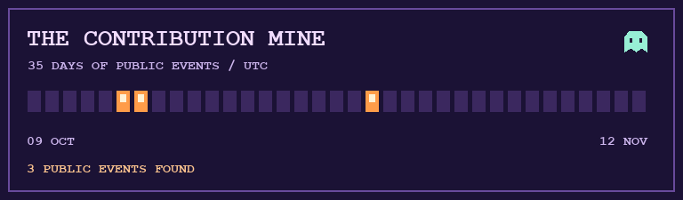

# ⛏️ The contribution mine

A ghost is sorting the public activity feed by lantern light.

| Day (UTC) | Lanterns | Public events |
| --- | --- | ---: |
| 2026-10-28 | 🟧 | 1 |
| 2026-10-15 | 🟧 | 1 |
| 2026-10-14 | 🟧 | 1 |

Snapshot captured November 12, 2026. Each lantern represents an event returned by GitHub’s public events feed. The feed is limited and does not represent all contributions.

[See the live contribution graph](https://github.com/abhinav-neander#contribution-graph) · [Back to the foyer](foyer.md) · [Visit the graveyard](graveyard.md)
